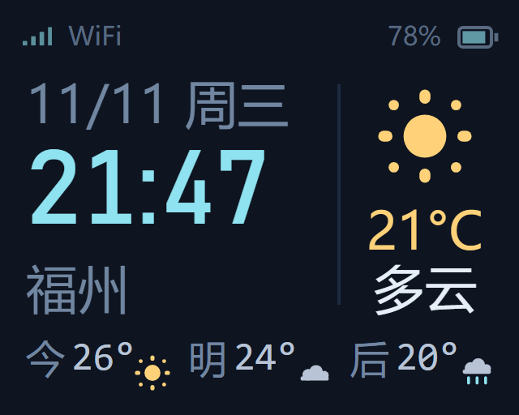
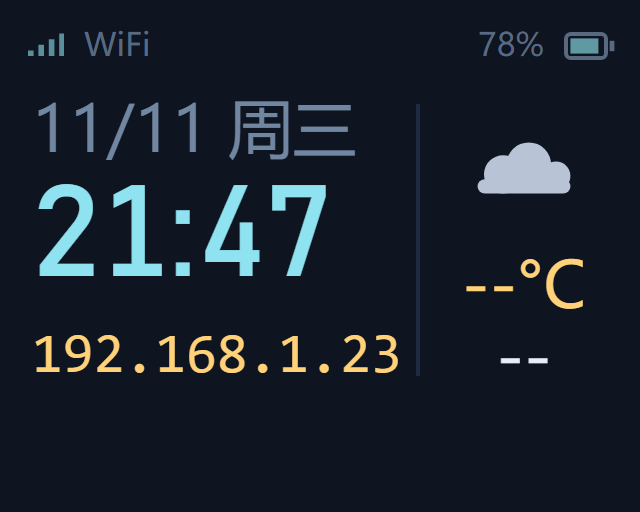
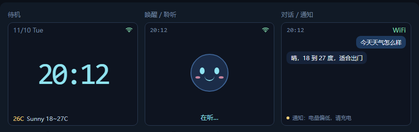
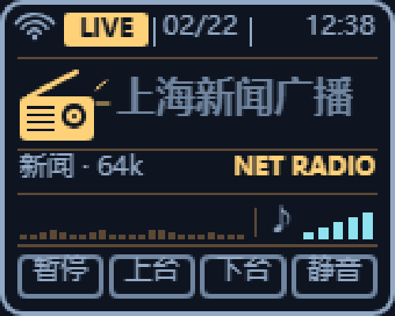
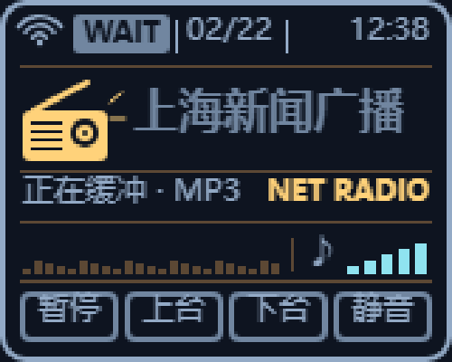
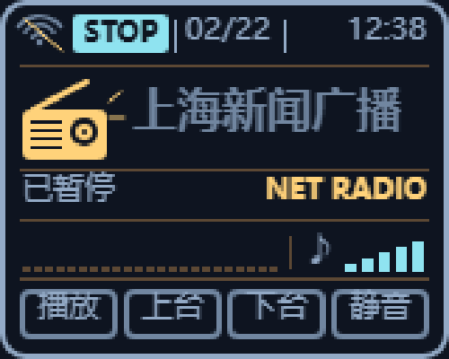
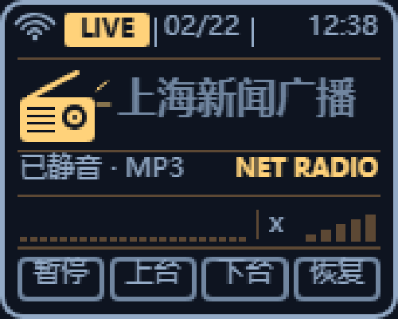
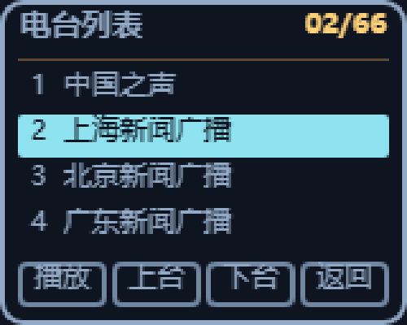
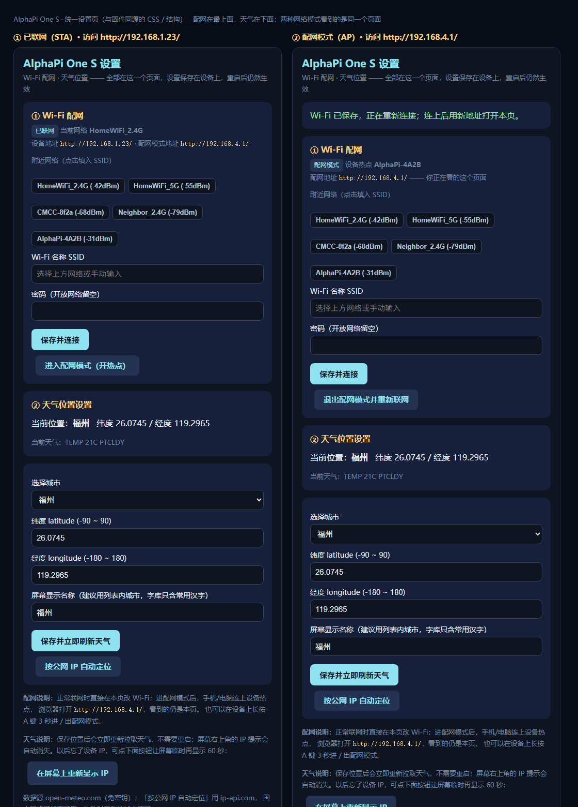

# AlphaPi One S · 深色桌面时钟双固件

> 一块 ESP32-S2 桌面设备，两套固件共存：**ota_0 = 小智语音（自定义深色时钟页 + 中文天气 + 配网页）**，
> **ota_1 = 网络收音机（M2b 日期色版）**。长按 D 键在两个槽之间互切，Wi-Fi 配置共用，互不干扰。

这是独立于 [AlphaPi-OneS-4in1](https://github.com/mastomato/AlphaPi-OneS-4in1) 的另一条固件线：
本仓库专注「桌面时钟 + 天气 + 小智 + 收音机」，不含游戏、倒计时等功能；两者板级架构不同，不能混刷。

## 硬件

| 项目 | 规格 |
|---|---|
| 主控 | ESP32-S2（单核 240 MHz，2 MB 外挂 PSRAM） |
| 屏幕 | 160×128 ST7735 SPI |
| 音频 | N32 协处理器，半双工 UART @ 460800，24 kHz / 8 bit 无符号 PCM |
| 输入 | 4 键（A / B / C / D），长按 D 切换小智 / 收音机 |
| Flash | 8 MB，双 OTA 槽（0x20000 / 0x310000） |

## 界面预览

所有界面按 160×128 实机像素绘制（放大展示）。屏幕截图源文件在 [docs/screens/](docs/screens/)。

### 小智槽（ota_0）

**桌面时钟页** — 深色 `#0E1420`，左「日期 / 大字时间 / 城市」+ 右「天气图标 / 温度 / 天气」，
底部三天预报（今 / 明 / 后）：

| 已配置天气（v11 B 版定稿） | 未配置天气位置（显示 IP + 设置提示） |
|---|---|
|  |  |

**小智对话** — 待机 / 唤醒聆听 / 对话气泡三态（同一套深色主题）：



### 收音机槽（ota_1）— M2b 日期色版（v16 新配色）

| 播放中 · LIVE | 缓冲中 · WAIT | 已暂停 · STOP |
|---|---|---|
|  |  |  |

| 静音 · MUTE | 电台列表 | v15 原配色对照 |
|---|---|---|
|  |  | [配色总览](firmware/v16/extras/M2b日期色版-预览总览.png) |

四个按键块与电台名用日期色 `#7186A0`，LIVE / 电台图标等暖色为播报色 `#FFD27A`，
频谱高条 / 选中行用青 `#8FE3F0` —— 即 v16 相对 v15 的唯一变化。

### 开发中的统一设置页（⚠️ 不属于 v16）

下图是配网 + 天气合并为单页的「统一设置页」预览，STA / AP 两种网络模式下看到的是同一页面。
**该页面属于 v16 之后的开发版本，未包含在 v16 发布的固件里**（该版本因音频断流问题未发布，
设备当前可用版本仍是 v16 的独立配网页 + 天气设置页）。放在这里仅供预览功能设计方向：



原始预览稿（含逐项说明与坐标参数）：[docs/统一设置页预览-20261112.html](docs/统一设置页预览-20261112.html)。

## 最新发布

**[v16 · 2026-11-12](firmware/v16/README.md)** — M2b 日期色收音机并入整包

- `firmware/v16/` — 六段式完整刷机包（bootloader / 分区表 / otadata / 小智 / 收音机 / 资源包），
  含一键刷机脚本、浏览器 web flasher、md5 校验清单与配色预览。
- 想快速上手，直接看 [firmware/v16/README.md](firmware/v16/README.md) 的「刷机前必做」和「六段文件与地址」。

### v16 是什么

相对 v15，**唯一变化的镜像是 `radio.bin`**：把四个按键块（暂停 / 上台 / 下台 / 静音）和电台名称
的颜色改成小智首页的日期色 `#7186A0`，与整机深色风格统一。改动方式是**二进制补丁**（6 个颜色常量
+ 6 条 `l32r` 引用重定向，共 60 字节），不改一行源码、不重新编译——因为当前收音机镜像里的
长按 D 切槽逻辑是重编会丢的。补丁脚本和改色前的原版回滚固件都放在 `firmware/v16/extras/`。

小智侧的深色时钟页（`#0E1420` 底 + 青 `#8FE3F0` / 暖黄 `#FFD27A`）、中文天气与温度、
矢量天气图标、三天预报，在 v10–v15 已定型；v16 的小智镜像与 v15 逐字节一致。

完整的历史版本演进（v1 → v16 每一版改了什么）见 [CHANGELOG.md](CHANGELOG.md)。

## 刷机速览

六段一次写入（地址见下表），或用 `firmware/v16/flash_all.py` / `alphapi-one-s-web-flasher.html` 一键完成：

| 地址 | 文件 | 说明 |
|---|---|---|
| `0x001000` | `bootloader.bin` | ESP-IDF 6.0 bootloader |
| `0x008000` | `partition-table.bin` | 双 OTA 槽分区表 |
| `0x00D000` | `ota_data_initial.bin` | 把启动槽设为 ota_0 = 小智 |
| `0x020000` | `xiaozhi.bin` | 小智语音 + 桌面时钟 + 天气 |
| `0x310000` | `radio.bin` | 网络收音机（M2b 日期色版） |
| `0x600000` | `generated_assets.bin` | 完整资源包（字体 + 表情 + 皮肤） |

`nvs` 分区（0x9000）**不在这六段里**，刷机后已保存的 Wi-Fi 不会丢。

> 从 v15 升级只需写一段：`write_flash 0x310000 radio.bin`，其余五段不动。
> 参数用下划线 `no_reset` / `default_reset`（本机 esptool 4.8.1 不认连字符写法）。

## 校验

`firmware/v16/md5sums.txt` 列出六段镜像的 md5，用附带脚本自检：

```
python flash_all.py --check-only
```

`radio.bin` 经 `esptool image_info` 校验 `Checksum valid` / `Validation Hash valid`。

## 许可与致谢

见 [LICENSE](LICENSE) 与 [THIRD_PARTY_NOTICES.md](THIRD_PARTY_NOTICES.md)。
本仓库的固件基于开源项目 [xiaozhi-esp32](https://github.com/78/xiaozhi-esp32)，保留其 MIT 许可与版权声明。

> v16 的收音机改色尚未上板实测；配色引用表已定位清楚，如某处颜色不符，改对应一条 `l32r` 即可修正。
> 欢迎在 Issues 反馈现象。
